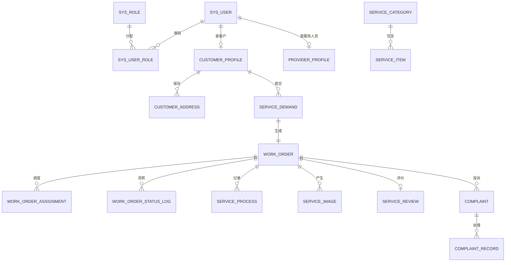

# 数据库关系说明

客户提交 `service_demand`，审核后生成一对一 `work_order`；调度结果保存在 `work_order_assignment`，服务人员的签到、开始、过程和完成信息保存在 `service_process`，服务前后图片保存在 `service_image`，客户确认后产生 `service_review`。投诉处理通过 `complaint` 和 `complaint_record` 留痕。
