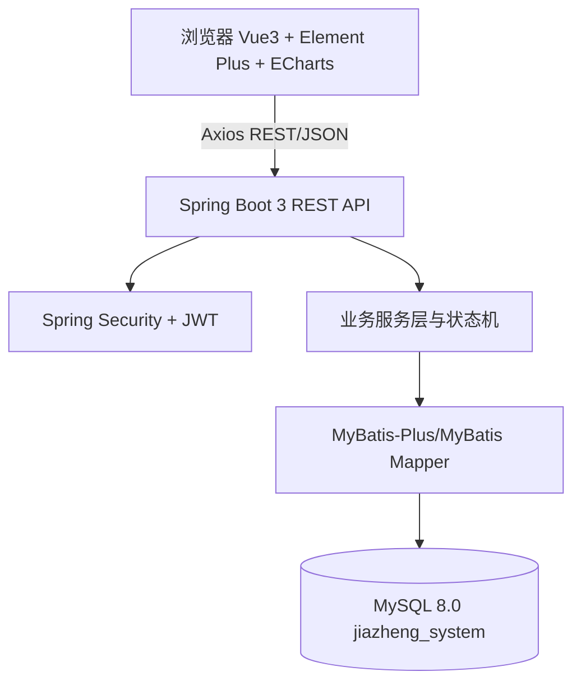

# 系统架构设计

## 1. 总体架构

前端使用 Vite 构建，开发环境将 `/api` 转发到 8080 端口；后端按 Controller、Service、Mapper 分层，事务边界放在审核、派单、过程和验收等业务服务中；数据库通过外键、索引和中文注释维护业务关联。

## 2. 安全设计

登录成功后签发 JWT，过滤器从 Bearer 请求头恢复用户 ID 和角色。接口使用 `@PreAuthorize` 限制角色，服务层再次检查客户地址、工单归属和服务人员分配关系。密码不以明文保存，公开配置只提供密钥占位符。

## 3. 部署边界

本项目是单体 Web 应用，前后端分离但不拆分为微服务；图片字段只保存安全的上传文件标识，文件存储策略由部署环境配置。系统没有支付或资金相关组件。
